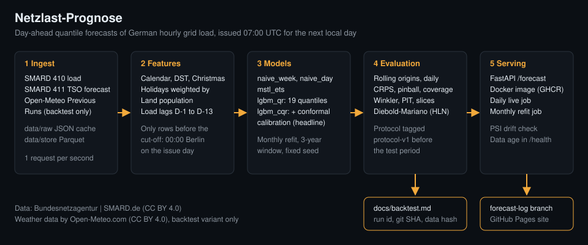

# Netzlast-Prognose

[](https://github.com/HARISPAARTAN/netzlast-prognose/actions/workflows/ci.yml)

Kalibrierte Wahrscheinlichkeitsprognosen der deutschen Netzlast für den nächsten Tag, mit vorregistriertem Backtest,
FastAPI-Dienst in Docker und täglichem Live-Protokoll.

English version: [README.en.md](README.en.md)



## Kurzfassung

**CRPS 42 Prozent unter der saisonal-naiven Basislinie auf 730 vorregistrierten Testtagen (Gitternäherung aus 19
Quantilen); die 80- und 90-Prozent-Intervalle decken 80.1 und 89.8 Prozent ab.**

- Jeden Morgen um 07:00 UTC: 19 Quantile der stündlichen Netzlast (SMARD, Region DE) für den nächsten lokalen Tag.
- Hauptmodell `lgbm_cqr`: LightGBM-Quantilregression mit konformer Kalibrierung. Saisonal-naive Basislinie
  (`naive_week`): dieselbe Stunde der Vorwoche.
- Bewertet auf zwei Testjahren (2024-10-01 bis 2026-09-30) nach einem Protokoll, das vor der Auswertung als Git-Tag
  `protocol-v1` eingefroren wurde. Kleine Vorabtests vor dem Tag sind in
  [docs/backtest-log.md](docs/backtest-log.md) offengelegt.
- Der Live-Betrieb läuft seit 2026-10-25. Live-Zahlen werden erst nach 56 bewerteten Tagen genannt; bis dahin gibt es
  keine.

## Ergebnisse

Lauf `test-v1` (730 Ursprünge, 17 520 Stundenwerte je Modell), Details und Herkunft jeder Zahl in
[docs/backtest.md](docs/backtest.md). CRPS und MAE in MWh je Stunde; der CRPS ist die Gitternäherung aus den 19
Quantilen (2/(K+1) mal die Summe der Pinball-Verluste), nicht das exakte Integral. Zahlen mit Dezimalpunkt wie in den
Ergebnisdateien.

| Modell | CRPS | MAE | Abdeckung 80 % | Abdeckung 90 % |
|---|---:|---:|---:|---:|
| lgbm_cqr | 1,201.6 | 1,686.3 | 0.801 | 0.898 |
| lgbm_qr (ohne Kalibrierung) | 1,265.0 | 1,686.3 | 0.529 | 0.654 |
| mstl_ets | 1,696.2 | 2,208.6 | 0.891 | 0.937 |
| naive_week | 2,071.1 | 2,781.7 | 0.774 | 0.863 |
| Referenz der Netzbetreiber (411), siehe Vorbehalt | 1,355.9 | 1,893.4 | 0.770 | 0.870 |

- H1 (besser als `naive_week` und `mstl_ets`): gestützt. CRPS 1,201.6 gegen 2,071.1 für `naive_week` (-42.0 %) und
  1,696.2 für `mstl_ets`; einseitige Diebold-Mariano-p-Werte 6.7e-17 und 6.2e-13.
- H2 (Abdeckung innerhalb ±2 Punkte und besser als ohne Kalibrierung): gestützt. 0.801 und 0.898 gegen 0.529 und
  0.654 ohne Kalibrierung.
- H3 (Wetter hilft, ab 2025): gestützt, aber nur als Teilzeitraum-Ergebnis. Auf den 638 Ursprüngen ab 2025-01-01 liegt
  der CRPS mit Wetter bei 1,118.3 gegen 1,201.8 ohne (-6.9 %). Das Wettermodell `lgbm_cqr_wx` gibt es nur im
  Backtest; der Live-Job nutzt kein Wetter.
- Gegenüber der Referenz der Netzbetreiber liegt der CRPS von `lgbm_cqr` um 11.4 % niedriger (1,201.6 gegen 1,355.9).
  **Vorbehalt Serie 411:** Die Referenz ist SMARD-Filter 411, hier als Day-ahead-Prognose der Netzbetreiber
  behandelt. Das wurde nur an einem einzigen Stundenwert des SMARD-Diagramms geprüft; Veröffentlichungszeit und
  Fassung sind unbekannt, und die Referenz hat womöglich Informationen, die das Modell zur Ausgabezeit nicht hat. Die
  Quantile (`tso_reference`) sind unsere eigene Konstruktion aus den Residuen der letzten 56 Tage, keine Prognose der
  Netzbetreiber. Der Vergleich ist ein Maßstab, kein fairer Wettkampf.
- Unter einem früheren Informationsstand (12:00 am Vortag, Lauf `test-v1-noon`) steigt der CRPS von `lgbm_cqr` um
  1.9 % auf 1,224.0.

## Live-Seite

[harispaartan.github.io/netzlast-prognose](https://harispaartan.github.io/netzlast-prognose/): aktueller Fächer der
Prognose, Backtest-Tabelle mit den Vorbehalten, Zuverlässigkeitsdiagramm, PIT-Histogramm und die rollierenden
Live-Fehler. Live-Zahlen erscheinen erst nach 56 bewerteten Tagen; die Seite zeigt bis dahin nur die Anzahl. Jede
Prognose wird vor ihrem Zieltag als Commit auf dem Branch
[`forecast-log`](https://github.com/HARISPAARTAN/netzlast-prognose/tree/forecast-log) abgelegt und nie überschrieben;
Format und Änderungen des Protokolls: [docs/live-log.md](docs/live-log.md).

## Methode

- Merkmale nur aus Daten vor 00:00 Uhr (Europe/Berlin) am Ausgabetag: Kalender, Feiertage gewichtet mit der
  Bevölkerung der Länder, Lastwerte von D-1 bis D-13.
- Ein LightGBM-Modell je Quantil, monatlich neu trainiert auf drei Jahren; die Intervalle werden über die letzten 56
  Prognosen konform kalibriert.
- Rollierender Backtest mit einem Ursprung pro Tag; CRPS, Pinball-Verlust, Abdeckung, Winkler-Score, PIT und
  Diebold-Mariano-Tests. Die Zahlen stammen aus dem Verfahren der monatlichen Neuschätzung (jeder Monat wird vom davor
  trainierten Modell bewertet), nicht vom ausgelieferten Modell.
- Betrieb: täglicher Live-Lauf, monatliche Neuschätzung als Release-Asset (nie ersetzt, Herkunft in
  `models/refit-log.csv`), PSI-Drift der Lag-Merkmale über 365 Tage, Datenalter in `/health`.

## Daten und Lizenzen

- Netzlast und Prognose der Netzbetreiber: Bundesnetzagentur | SMARD.de, Lizenz CC BY 4.0.
- Wetter (nur Backtest-Variante): Weather data by Open-Meteo.com (https://open-meteo.com/), Lizenz CC BY 4.0.
- Bevölkerung der Länder: © Statistisches Bundesamt (Destatis), 2026. Vervielfältigung und Verbreitung, auch
  auszugsweise, mit Quellennachweis gestattet.
- Code: MIT-Lizenz.

## Schnellstart

Demo (offline, gebündelter Fixture-Zeitraum). Das Image lässt sich auch selbst bauen:
`docker build -t netzlast-prognose .`.

```bash
docker run --rm -p 8000:8000 ghcr.io/harispaartan/netzlast-prognose:0.1.0
curl "http://127.0.0.1:8000/forecast?target_date=2025-10-26"
```

Voller Modus mit eigenen Daten (Store aus `lastprog fetch`, Modell aus `lastprog train` oder dem Release-Asset
`models`):

```bash
uv sync --locked --all-extras
uv run lastprog fetch --from 2023-01-01
uv run lastprog train --as-of 2026-10-01
uv run lastprog forecast
uv run lastprog serve        # API auf Port 8000
```

Weitere Befehle: `lastprog backtest --run-id ... --period validation|test` (der Testzeitraum läuft nur mit dem Tag
`protocol-v1`), `lastprog tune`, `lastprog live --log-dir <forecast-log>`, `lastprog report --log-dir <forecast-log>`,
`lastprog refit-log`, `lastprog repair-store`.

Das Docker-Image im vollen Modus:

```bash
docker run --rm -p 8000:8000 -e LASTPROG_MODE=full -e LASTPROG_DATA_DIR=/data \
  -v "$PWD/data/store:/data/store:ro" -v "$PWD/models:/data/models:ro" \
  ghcr.io/harispaartan/netzlast-prognose:0.1.0
```

## API

- `GET /health`: Status (`ok` oder `degraded`, dann HTTP 503), Modellversion, Git-SHA und Datei-Digest des Modells,
  Alter der Daten (`degraded` ab 48 Stunden).
- `GET /forecast?target_date=YYYY-MM-DD&model=lgbm_cqr`: 23 bis 25 Stunden mit Median, 19 Quantilen und Intervallen;
  `model` ist `lgbm_cqr` oder `naive_week`. Fehler: 400 (ungültiges Datum), 404 (unbekanntes Modell), 409 (Daten
  noch nicht da), 503 (kein Modell).
- `GET /models`: Modelle mit Trainingsfenster, Merkmalen, Herkunft (`built_on`, `training_data`) und den Testmetriken
  des Backtest-Verfahrens, ausdrücklich nicht als Bewertung des ausgelieferten Modells. OpenAPI unter `/docs`.

## Reproduzierbarkeit

`uv.lock` mit festem Stichtag, feste Seeds, deterministisches LightGBM. Wiederholt wurde nur der Sensitivitätslauf
(`lgbm_cqr` und `naive_week`, 12:00-Regel) auf demselben Rechner und Datenstand; er war byte-gleich. MSTL, der
Wetterpfad und andere Plattformen sind nicht wiederholt worden. Befehle, Git-SHA, Datenhash und Laufzeit jedes Laufs
stehen in [docs/backtest.md](docs/backtest.md); das Protokoll in [docs/protocol.md](docs/protocol.md), Abweichungen in
[docs/backtest-log.md](docs/backtest-log.md). Die Ausgaben je Ursprung, ein Digest über das Protokollfenster der
Daten und die Prüfbefehle liegen als Assets am Release v0.1.0 (Abschnitt "Belege und Nachprüfung" in
[docs/backtest.md](docs/backtest.md)); der ursprüngliche Datenhash des Gesamtstores ist nicht mehr nachprüfbar. Die Gewichte des ausgelieferten Modells stammen aus einem CI-Lauf und
sind nicht byte-gleich mit einem lokalen Nachtraining (siehe unten und [docs/model-card.md](docs/model-card.md)).

## Was nicht funktioniert hat

- **Falsche CRPS-Näherung im Entwurf.** "Zweimal mittlerer Pinball-Verlust" lag rund 5 % über dem exakten Wert einer
  Normalverteilung; ersetzt durch 2/(K+1) mal die Summe der Pinball-Verluste (vor dem Einfrieren dokumentiert). Auch
  so bleibt es eine Gitternäherung aus 19 Quantilen.
- **Falsche Prozentzahl in der Doku.** `docs/backtest.md` nannte für `naive_week` unter der 12:00-Regel +70.6 %; es
  sind +0.7 % (2,085.7 gegen 2,071.1). Der Faktor 100 war doppelt angewendet worden und kehrte die Aussage um (das
  Modell verliert mehr als die Basislinie). Im Review gefunden und korrigiert.
- **Die Referenz der Netzbetreiber war zu glatt dargestellt.** Der erste Stand der Dokumente nannte Serie 411 ohne
  Einschränkung "Prognose der Netzbetreiber". Geprüft war ein einziger Wert im SMARD-Diagramm; die Quantile sind eine
  eigene Konstruktion. Die Vorbehalte stehen jetzt in Backtest-Bericht, Model Card, ADR-003, auf der Seite und oben.
  Der CRPS-Vorsprung von 11.4 % ist deshalb kein Beleg, besser als die Netzbetreiber zu sein.
- **Vorabtests vor dem Einfrieren.** Bei einer Prüfung wurde das Wettermodell auf drei Ursprüngen im März 2025 bewertet,
  und es gab Laufzeittests mit 60 Ursprüngen, bevor `protocol-v1` getaggt war. Nichts wurde daraufhin geändert oder
  getunt; offengelegt in `docs/backtest-log.md`. Streng "vorregistriert" ist der Test also mit dieser Einschränkung.
- **Tests, die einen Fehler nicht sahen.** Der Leck-Test fing ein Leck in die Modellanpassung nicht ab, die
  Service-Tests keine Daten ab dem Stichtag, die Live-Tests keine um eine Stunde verschobenen Ist-Werte. Gefunden
  durch bewusst eingebaute Fehler; behoben mit Tests, die dann fehlschlagen. Zudem wurden anfangs fehlende Werte
  als Fehltreffer gewertet; heute gelten sie als fehlend.
- **PSI-Drift mit 28-Tage-Fenster.** Der erste Live-Eintrag zeigte PSI-Werte von 0.26 bis 5.1, weil das Lastniveau der
  Jahreszeit folgt und das Referenzfenster drei Jahre umfasst. Mit 28 Tagen hätte die Prüfung dauerhaft Alarm
  geschlagen; auf wöchentlichen Fenstern lagen 90 bis 100 % über 0.2, mit 365 Tagen 0 %. Seit der ersten Korrektur
  gilt das 365-Tage-Fenster; der erste Eintrag wurde neu berechnet, die Originalwerte bleiben darin erhalten.
- **CI-Gewichte gegen lokale Gewichte.** Das ausgelieferte Modell wurde im Refit-Workflow trainiert. Ein lokales
  Nachtraining mit gleichem Code, gleichen Zeilen und Fenstern ergibt andere Dateien; die Ursache ist nicht
  nachgewiesen, am wahrscheinlichsten die Plattform. Dazu kam, dass das erneute Auslösen des Workflows das Asset unter
  derselben Version ersetzen konnte. Jetzt halten Manifest und Refit-Log Plattform, Versionen, Lauf-URL und einen
  Digest der gelesenen Daten fest, und ein Asset wird nie ersetzt.
- **Datenschicht.** Zeitstempel des Abrufs waren für die Referenzserie leer und wurden bei jedem Lauf überschrieben;
  ein fehlender SMARD-Index ließ den Abruf stumm mit Erfolg enden. Beides behoben und getestet.
- **Abhängigkeiten.** statsforecast 2.1.1 läuft nicht mit pandas 3; numpy 2.5 erzeugt Warnungen in pandas 2.3. Beide
  Grenzen sind gepinnt.
- **Rotes CI auf `main`.** Ein Commit ging mit rotem CI auf `main`, weil ein neuer Test von git-ignorierten
  Modelldateien abhing; der nächste Commit hat das behoben.
- **Keine der drei Hypothesen ist gescheitert.** Das spricht für das Verfahren auf diesen zwei Testjahren, sagt aber
  nichts über den Live-Betrieb. Schwach ist das Modell in der Weihnachtswoche (CRPS
  1,790.5, Abdeckung 80 % nur 0.719) und im Januar 2026 (CRPS 1,958.1).

## Grenzen

- Keine Schulferien, kein Wetter im Live-Betrieb, nur die Region DE.
- Konforme Kalibrierung setzt Austauschbarkeit voraus, die Zeitreihen nicht haben; Abdeckung wird empirisch geprüft.
- Das Wettermodell ist nur auf dem Teilzeitraum ab 2025-01-01 sauber vergleichbar.
- Kein Einsatz für Netzbetrieb oder Handel (siehe [docs/model-card.md](docs/model-card.md)).

## Roadmap

- Acht Wochen Live-Betrieb, dann Live-Metriken neben den Backtest-Werten.
- Day-ahead-Preis DE-LU mit eigenem Protokoll.
- Wetter im Live-Job nach Prüfung der Open-Meteo-Bedingungen.

## Offene Punkte für den Betreiber

1. **GHCR-Sichtbarkeit.** Neue Pakete auf GHCR sind meist privat. Nach dem Tag `v0.1.0` ließ sich das Image
   `0.1.0` am 2026-10-25 ohne Anmeldung abrufen (anonymer Manifest-Abruf lieferte 200), das Paket wirkt also öffentlich;
   der Zugriffstoken der Automatisierung durfte die Einstellung nicht lesen. Bitte unter den Paket-Einstellungen von
   `netzlast-prognose` bestätigen, dass die Sichtbarkeit "Public" ist, damit `docker run
   ghcr.io/harispaartan/netzlast-prognose:0.1.0` ohne Anmeldung funktioniert.
2. **Open-Meteo-Bedingungen.** Vor jeder Live-Nutzung von Wetter die Bedingungen unter
   https://open-meteo.com/en/terms lesen. Bis dahin bleibt `[weather] enabled = false`.
3. **Acht Wochen Wartezeit.** Keine Live-Metrik nennen, bevor 56 Tage auf `forecast-log` bewertet sind (bei lückenloser
   täglicher Ausgabe frühestens am 21. Dezember 2026). Prüfen, dass der tägliche Workflow `Forecast` weiterläuft; GitHub kann Zeitpläne in öffentlichen
   Repositories nach 60 Tagen ohne Aktivität pausieren, die monatliche Neuschätzung zählt als Aktivität.
